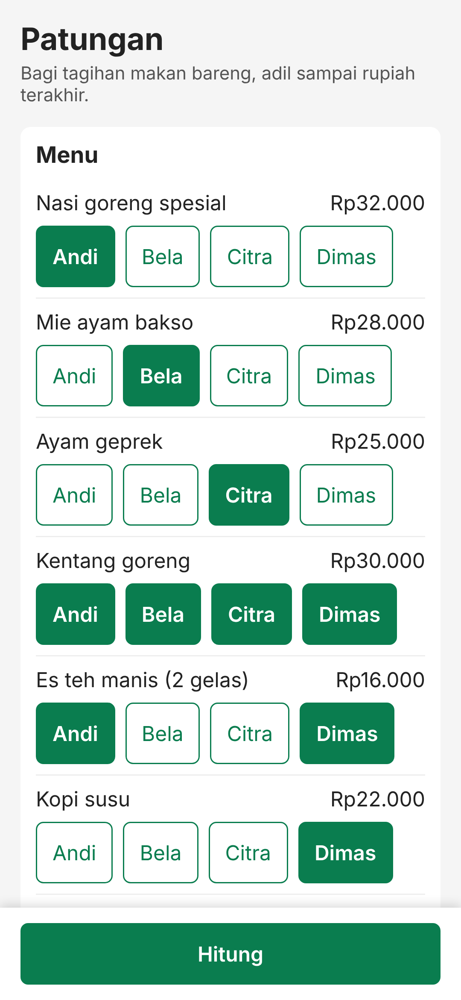
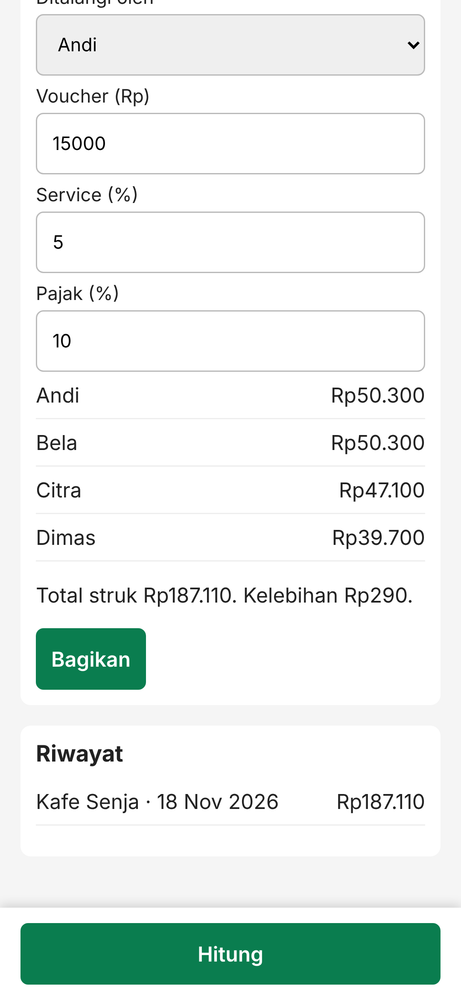

# Patungan

Aplikasi HP (PWA) untuk membagi tagihan makan bareng: voucher, service, dan pajak dibagi sebanding dengan pesanan tiap orang, bagian setiap orang dibulatkan ke atas ke kelipatan Rp100, ringkasan bisa dikirim ke WhatsApp, dan aplikasi tetap jalan tanpa internet.

Kode ini dibuat langkah demi langkah bersama asisten AI di video **"Vibe Coding yang Benar: Membuat Aplikasi Patungan Sampai Jadi (Claude Code)"** di kanal YouTube [@iTeachSWE](https://www.youtube.com/@iTeachSWE). Setiap commit adalah satu "titik aman" di video, jadi `git log` bisa diikuti bab demi bab.

- `SPEK.md`: spek satu halaman, termasuk aturan hitung dan contoh hitungan manual (kunci jawaban tes).
- `CLAUDE.md`: aturan kerja untuk asisten AI.

## Tampilan

<p>
  
  &nbsp;
  
</p>

Kiri: setiap menu diberi pemakannya dengan mengetuk nama orang. Kanan: hasil struk contoh di `SPEK.md` (voucher Rp15.000, service 5%, pajak 10%), sama persis dengan hitungan manual: Andi Rp50.300, Bela Rp50.300, Citra Rp47.100, Dimas Rp39.700, kelebihan Rp290 untuk yang menalangi.

## Menjalankan

Perlu Node.js 20 atau lebih baru.

```bash
npm install
npm run dev            # buka http://localhost:5173 di browser
npm run dev -- --host  # supaya bisa dibuka dari HP di Wi-Fi yang sama
npx vitest run         # jalankan semua tes
npm run build          # hasil siap terbit di folder dist/
npm run preview        # coba hasil build (service worker aktif)
```

Fitur pasang aplikasi dan mode offline di HP baru bisa dicoba setelah aplikasi terbit dengan alamat https, misalnya lewat Vercel atau GitHub Pages.
